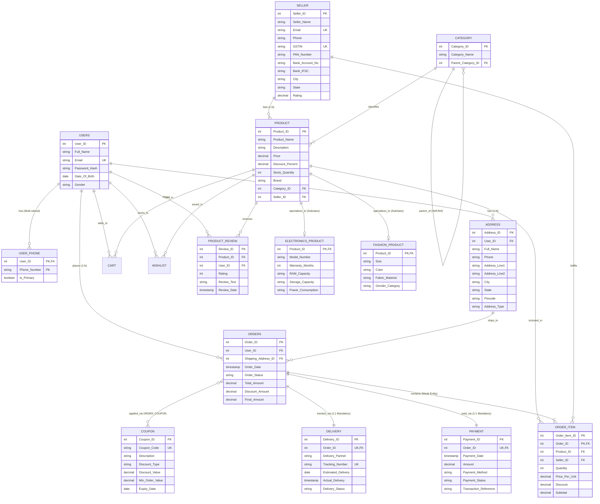

# DBMS Practical File

[](https://www.mysql.com/)
[](https://github.com/)
[](LICENSE)

A structured laboratory repository containing practical experiments, relational schema designs, datasets, and SQL query suites for **Database Management Systems (DBMS) Lab**.

---

## 📑 Index of Practical Experiments

| Exp No. | Experiment Title | Folder / Code | Status |
| :---: | :--- | :---: | :---: |
| **01** | **Indian E-Commerce Platform ER Modeling** | [`📁 Experiment-1`](./Experiment-1) | ✅ Completed |
| **02** | **ER Diagram to Relational Schema & Integrity Constraints** | [`📁 Experiment-2`](./Experiment-2) | ✅ Completed |
| **03** | **Employee–Department–Project Schema** | [`📁 Experiment-3`](./Experiment-3) | ✅ Completed |
| **04** | **Advanced SQL Queries & Execution Plans** | [`📁 Experiment-4`](./Experiment-4) | ✅ Completed |
| **05** | **SQL Views, View Updatability & Recursive CTE** | [`📁 Experiment-5`](./Experiment-5) | ✅ Completed |
| **06** | **Stored Procedures, Triggers & Audit Logging** | [`📁 Experiment-6`](./Experiment-6) | ✅ Completed |

---

## 📁 Repository Structure

```tree
DBMS-Practical-File-/
├── README.md                   # Master practical documentation & experiment index
├── .gitignore
├── Experiment-1/               # Experiment 1: Indian E-Commerce Platform ER Modeling
│   ├── schema.sql              # Relational DDL schema with constraints & specializations
│   ├── data.sql                # Realistic Indian e-commerce dataset
│   ├── queries.sql             # Relational queries validating ER relationships
│   ├── er_diagram.mermaid      # Standalone Mermaid ER diagram definition
│   └── complete_experiment1.sql# Unified executable all-in-one script
├── Experiment-2/               # Experiment 2: Relational Schema & Integrity Constraints
│   ├── schema.sql              # 18-Table DDL schema with ON DELETE CASCADE / SET NULL
│   ├── data.sql                # Sample data insertion across all relations
│   ├── integrity_tests.sql     # Referential integrity violations, SET NULL & CASCADE tests
│   └── complete_experiment2.sql# Unified executable all-in-one script
├── Experiment-3/               # Experiment 3: Employee-Department-Project Schema
│   ├── schema.sql              # Database creation and table definitions
│   ├── data.sql                # Dataset insertion (5 depts, 30 employees, 8 projects)
│   ├── queries.sql             # 18 Categorized SQL queries (A to G)
│   └── database_complete.sql   # Unified all-in-one executable script
├── Experiment-4/               # Experiment 4: Advanced SQL Queries & EXPLAIN Plans
│   ├── advanced_queries.sql    # 8 Advanced queries (Joins, Subqueries, Sets)
│   ├── explain_plans.sql       # EXPLAIN execution plan analysis
│   └── complete_experiment4.sql# Unified executable script for Experiment 4
├── Experiment-5/               # Experiment 5: SQL Views & Recursive CTE
│   ├── schema_update.sql       # Hierarchy alteration & manager assignments
│   ├── views_and_updatability.sql # Views creation & updatability tests
│   ├── recursive_cte.sql       # Hierarchical recursive CTE queries
│   └── complete_experiment5.sql# Unified executable script for Experiment 5
└── Experiment-6/               # Experiment 6: Stored Procedures, Triggers & Audit Logging
    ├── schema_and_data.sql     # Base tables, constraints, audit table & sample records
    ├── stored_procedures.sql   # transfer_employee procedure with exception handling
    ├── triggers_and_audit.sql  # Salary validation & automated audit logging triggers
    └── complete_experiment6.sql# Unified executable script for Experiment 6
```

---

# 🔬 Experiment 1: Design an ER Diagram for an Indian E-Commerce Platform

[](https://www.mysql.com/)
[](https://github.com/)
[](./Experiment-1/er_diagram.mermaid)

---

## 📌 Aim & Objectives

To design a comprehensive **Entity-Relationship (ER) Diagram** and implement its corresponding relational database schema for an **Indian E-Commerce Platform**, incorporating:
- Core entities: **Customer / User**, **Address**, **Seller** (with GSTIN), **Category**, **Product**, **Order**, **Order_Item**, **Payment**, **Delivery**, **Coupon**, **Cart**, **Wishlist**, and **Product_Review**.
- Key relational modeling concepts:
  - **Primary Keys** and candidate keys
  - **Composite Attributes** (e.g., Address flattened into structured attributes)
  - **Multi-valued Attributes** (e.g., User Phone numbers normalized into a dedicated table)
  - **Weak Entities** (`Order_Item` dependent on `Orders`)
  - **Specialization / Generalization** (Subclassing `Product` into `Electronics_Product` and `Fashion_Product`)
  - **Participation Constraints** (Total/mandatory vs Partial/optional participation)
  - **Self-Referencing Unary Relationship** (Hierarchical categories & subcategories)

---

## 📖 Theory & Core Concepts

An **Entity-Relationship (ER) Model** is a conceptual blueprint used in database engineering to represent the logical structure of an application domain before physical database creation.

### Key ER Components & Notations

1. **Entity:** A distinguishable real-world object or concept represented by a rectangle.
   - *Strong Entity:* Possesses an intrinsic primary key attribute (`Users`, `Seller`, `Product`, `Orders`).
   - *Weak Entity:* Lacks sufficient key attributes and depends existentially on an identifying owner entity via an identifying relationship (`Order_Item` identified through `Orders`).
2. **Attribute:** A descriptive property of an entity represented by an oval.
   - *Key Attribute:* Uniquely identifies an entity occurrence (underlined, e.g., `User_ID`, `Seller_ID`).
   - *Composite Attribute:* Composed of multiple constituent sub-attributes (e.g., Address broken down into `Address_Line1`, `City`, `State`, `Pincode`).
   - *Multi-valued Attribute:* May contain multiple values for a single entity instance (double oval, e.g., customer phone numbers `Phone_Number`).
3. **Relationship:** An association among two or more entities represented by a diamond.
   - *Cardinality Ratios:* 1 : 1 (Order to Payment), 1 : N (User to Orders, Seller to Products), N : M (Users to Products via Cart / Wishlist, Orders to Coupons).
4. **Specialization & Generalization:**
   - Top-down modeling where higher-level general superclass entities are divided into specialized subclasses sharing the superclass identity.
   - Superclass `Product` specializes into `Electronics_Product` (attributes: `Model_Number`, `RAM_Capacity`, `Storage_Capacity`, `Warranty_Months`) and `Fashion_Product` (attributes: `Size`, `Color`, `Fabric_Material`, `Gender_Category`).
5. **Participation Constraints:**
   - *Total (Mandatory) Participation:* Every entity in the set must participate in the relationship (represented by double lines, e.g., an `Orders` entity must have a `Payment` and an assigned `Users`).
   - *Partial (Optional) Participation:* Entities may exist without participating in the relationship (represented by single lines, e.g., a registered `Users` who has never placed an `Orders`).

---

## 🗺️ Entity-Relationship (ER) Diagram



---

## 🗄️ Relational Schema Architecture & Table Specifications

The conceptual ER model maps directly to 15 relational tables in MySQL adhering to Third Normal Form (3NF):

| Relational Table | Primary Key | Foreign Key(s) | Architectural Concept / Purpose |
| :--- | :--- | :--- | :--- |
| **`Users`** | `User_ID` | *None* | Strong customer entity profile and authentication credentials |
| **`User_Phone`** | `(User_ID, Phone_Number)` | `User_ID` → `Users` | First normal form resolution of multi-valued phone numbers |
| **`Address`** | `Address_ID` | `User_ID` → `Users` | Decomposition of composite address attribute (1 : N per user) |
| **`Seller`** | `Seller_ID` | *None* | Indian merchant registry holding statutory GSTIN and bank details |
| **`Category`** | `Category_ID` | `Parent_Category_ID` → `Category` | Self-referencing unary tree for product taxonomy |
| **`Product`** | `Product_ID` | `Category_ID`, `Seller_ID` | General merchandise superclass |
| **`Electronics_Product`** | `Product_ID` | `Product_ID` → `Product` | Specialization subclass with RAM, Storage, and Warranty attributes |
| **`Fashion_Product`** | `Product_ID` | `Product_ID` → `Product` | Specialization subclass with Size, Fabric, and Color attributes |
| **`Orders`** | `Order_ID` | `User_ID`, `Shipping_Address_ID` | Central commercial order record |
| **`Order_Item`** | `(Order_Item_ID, Order_ID)`| `Order_ID`, `Product_ID`, `Seller_ID` | Weak entity identified through composite relation with owner `Orders` |
| **`Payment`** | `Payment_ID` | `Order_ID` → `Orders` (UNIQUE) | 1:1 Mandatory payment transaction tracking |
| **`Delivery`** | `Delivery_ID` | `Order_ID` → `Orders` (UNIQUE) | 1:1 Indian logistics fulfillment tracking (BlueDart, Delhivery) |
| **`Coupon`** | `Coupon_ID` | *None* | Promotional campaign discounts |
| **`Order_Coupon`** | `(Order_ID, Coupon_ID)` | `Order_ID`, `Coupon_ID` | Junction table resolving M:N relationship between Orders and Coupons |
| **`Cart` / `Wishlist`** | `Cart_ID` / `Wishlist_ID`| `User_ID`, `Product_ID` | Junction tables capturing shopping cart and saved merchandise |
| **`Product_Review`** | `Review_ID` | `Product_ID`, `User_ID` | Customer feedback ratings and verified buyer reviews |

---

## 📁 Experiment 1 Files

```tree
Experiment-1/
├── schema.sql              # Relational DDL schema with constraints & specializations
├── data.sql                # Realistic Indian e-commerce dataset
├── queries.sql             # Relational queries validating ER relationships
├── er_diagram.mermaid      # Standalone Mermaid ER diagram definition
└── complete_experiment1.sql# Unified executable all-in-one script
```

---

## 🚀 Getting Started / Execution Guide (Experiment 1)

### Method 1: Using MySQL Command Line Client

1. Open your terminal inside the repository folder.
2. Log into MySQL:
   ```bash
   mysql -u root -p
   ```
3. Run the unified SQL script:
   ```sql
   SOURCE Experiment-1/complete_experiment1.sql;
   ```
   *Or execute modularly:*
   ```sql
   SOURCE Experiment-1/schema.sql;
   SOURCE Experiment-1/data.sql;
   SOURCE Experiment-1/queries.sql;
   ```

### Method 2: Using MySQL Workbench

1. Open **MySQL Workbench** and connect to your local database server.
2. Open `Experiment-1/complete_experiment1.sql`.
3. Click the ⚡ **Execute (All Queries)** button.
4. Review the created schema, seeded Indian e-commerce datasets, and query verification grids.

---

## 📊 Relational Queries & Verification Output Catalog

### 1. Customer Order Summary with Shipping Address
Validates 1:N relationship from `Users` to `Orders` and composite `Address` dereferencing:

```sql
SELECT 
    o.Order_ID,
    u.Full_Name AS Customer_Name,
    CONCAT(a.Address_Line1, ', ', a.City, ', ', a.State, ' - ', a.Pincode) AS Shipping_Address,
    a.Address_Type,
    o.Order_Date,
    o.Order_Status,
    o.Final_Amount
FROM Orders o
INNER JOIN Users u ON o.User_ID = u.User_ID
INNER JOIN Address a ON o.Shipping_Address_ID = a.Address_ID
ORDER BY o.Order_ID;
```

**Output:**
```
+----------+---------------+------------------------------------------------------+--------------+---------------------+--------------+--------------+
| Order_ID | Customer_Name | Shipping_Address                                     | Address_Type | Order_Date          | Order_Status | Final_Amount |
+----------+---------------+------------------------------------------------------+--------------+---------------------+--------------+--------------+
|     1001 | Aarav Sharma  | Flat 402, Royal Palms, Noida, Uttar Pradesh - 201301 | Home         | 2026-10-20 10:15:00 | Delivered    |     62999.00 |
|     1002 | Priya Patel   | B-12, Shanti Kunj Apartments, Mumbai, Maharashtra... | Home         | 2026-10-22 14:30:00 | Shipped      |      4999.00 |
|     1003 | Ananya Iyer   | 34, 4th Main Road, Indiranagar, Bengaluru, Karnat... | Home         | 2026-10-24 16:45:00 | Confirmed    |      1299.00 |
+----------+---------------+------------------------------------------------------+--------------+---------------------+--------------+--------------+
```

---

### 2. Line-Item Order Breakdown (Weak Entity `Order_Item` Traversal)
Traverses the multi-table path `Orders` ↔ `Order_Item` ↔ `Product` ↔ `Seller` ↔ `Category`:

```sql
SELECT 
    oi.Order_ID,
    p.Product_Name,
    c.Category_Name,
    s.Seller_Name,
    s.GSTIN,
    oi.Quantity,
    oi.Price_Per_Unit,
    oi.Subtotal
FROM Order_Item oi
INNER JOIN Product p ON oi.Product_ID = p.Product_ID
INNER JOIN Category c ON p.Category_ID = c.Category_ID
INNER JOIN Seller s ON oi.Seller_ID = s.Seller_ID
ORDER BY oi.Order_ID;
```

**Output:**
```
+----------+--------------------------------+---------------------------+-------------------------+-----------------+----------+----------------+----------+
| Order_ID | Product_Name                   | Category_Name             | Seller_Name             | GSTIN           | Quantity | Price_Per_Unit | Subtotal |
+----------+--------------------------------+---------------------------+-------------------------+-----------------+----------+----------------+----------+
|     1001 | OnePlus 12 5G (Flowy Emerald)  | Smartphones & Accessories | TechBazaar Retail India | 07AAACT1234A1Z5 |        1 |       64999.00 | 62999.00 |
|     1002 | Pure Banarasi Silk Saree       | Ethnic Wear               | Heritage Silk Weavers   | 24AABCH3456D1Z1 |        1 |        5499.00 |  4999.00 |
|     1003 | Men Cotton Straight Kurta      | Ethnic Wear               | DesiTrends Fashion Hub  | 08AABCF4567B1Z2 |        1 |        1299.00 |  1299.00 |
+----------+--------------------------------+---------------------------+-------------------------+-----------------+----------+----------------+----------+
```

---

### 3. Payment and Coupon Verification (1:1 Payment & M:N Coupon)
Verifies payment channel (`UPI`, `Debit_Card`, `COD`), transaction status, and promotional savings:

```sql
SELECT 
    o.Order_ID,
    o.Total_Amount,
    COALESCE(cp.Coupon_Code, 'None') AS Coupon_Applied,
    o.Discount_Amount,
    o.Final_Amount,
    pm.Payment_Method,
    pm.Payment_Status
FROM Orders o
LEFT JOIN Payment pm ON o.Order_ID = pm.Order_ID
LEFT JOIN Order_Coupon oc ON o.Order_ID = oc.Order_ID
LEFT JOIN Coupon cp ON oc.Coupon_ID = cp.Coupon_ID
ORDER BY o.Order_ID;
```

**Output:**
```
+----------+--------------+----------------+-----------------+--------------+----------------+----------------+
| Order_ID | Total_Amount | Coupon_Applied | Discount_Amount | Final_Amount | Payment_Method | Payment_Status |
+----------+--------------+----------------+-----------------+--------------+----------------+----------------+
|     1001 |     64999.00 | DIWALI2026     |         2000.00 |     62999.00 | UPI            | Success        |
|     1002 |      5499.00 | FESTIVE500     |          500.00 |      4999.00 | Debit_Card     | Success        |
|     1003 |      1299.00 | None           |            0.00 |      1299.00 | COD            | Pending        |
+----------+--------------+----------------+-----------------+--------------+----------------+----------------+
```

---

### 4. Order Logistics & Delivery Tracking
Verifies Indian logistics fulfillment tracking (`BlueDart Express`, `Delhivery Logistics`, `Shadowfax`):

```sql
SELECT 
    o.Order_ID,
    u.Full_Name AS Customer,
    d.Delivery_Partner,
    d.Tracking_Number,
    d.Delivery_Status,
    d.Estimated_Delivery,
    d.Actual_Delivery
FROM Delivery d
INNER JOIN Orders o ON d.Order_ID = o.Order_ID
INNER JOIN Users u ON o.User_ID = u.User_ID
ORDER BY o.Order_ID;
```

**Output:**
```
+----------+--------------+---------------------+---------------------+------------------+--------------------+---------------------+
| Order_ID | Customer     | Delivery_Partner    | Tracking_Number     | Delivery_Status  | Estimated_Delivery | Actual_Delivery     |
+----------+--------------+---------------------+---------------------+------------------+--------------------+---------------------+
|     1001 | Aarav Sharma | BlueDart Express    | BLUEDART-IND-778899 | Delivered        | 2026-10-23         | 2026-10-23 15:40:00 |
|     1002 | Priya Patel  | Delhivery Logistics | DELHIVERY-DL-554433 | In_Transit       | 2026-10-26         | NULL                |
|     1003 | Ananya Iyer  | Shadowfax Express   | SHADOW-EXP-112233   | Order_Dispatched | 2026-10-28         | NULL                |
+----------+--------------+---------------------+---------------------+------------------+--------------------+---------------------+
```

---

### 5. Product Specialization: Subclass Queries

#### A. Electronics Catalog (`Electronics_Product`)
```sql
SELECT 
    p.Product_ID,
    p.Product_Name,
    p.Brand,
    p.Price,
    e.Model_Number,
    e.RAM_Capacity,
    e.Storage_Capacity,
    e.Warranty_Months
FROM Product p
INNER JOIN Electronics_Product e ON p.Product_ID = e.Product_ID;
```

**Output:**
```
+------------+-------------------------------+---------+----------+---------------+--------------+------------------+-----------------+
| Product_ID | Product_Name                  | Brand   | Price    | Model_Number  | RAM_Capacity | Storage_Capacity | Warranty_Months |
+------------+-------------------------------+---------+----------+---------------+--------------+------------------+-----------------+
|          1 | OnePlus 12 5G (Flowy Emerald) | OnePlus | 64999.00 | OP-12-GRN-256 | 16 GB        | 256 GB           |              12 |
|          2 | Apple MacBook Air M2          | Apple   | 89900.00 | MLXW3HN/A     | 8 GB         | 256 GB SSD       |              12 |
|          5 | boAt Airdopes 141 ANC         | boAt    |  1799.00 | AD-141-ANC-BLK| N/A          | N/A              |              12 |
+------------+-------------------------------+---------+----------+---------------+--------------+------------------+-----------------+
```

#### B. Fashion Catalog (`Fashion_Product`)
```sql
SELECT 
    p.Product_ID,
    p.Product_Name,
    p.Brand,
    p.Price,
    f.Size,
    f.Color,
    f.Fabric_Material,
    f.Gender_Category
FROM Product p
INNER JOIN Fashion_Product f ON p.Product_ID = f.Product_ID;
```

**Output:**
```
+------------+---------------------------+---------------+---------+------------------+--------------------+-------------------------+-----------------+
| Product_ID | Product_Name              | Brand         | Price   | Size             | Color              | Fabric_Material         | Gender_Category |
+------------+---------------------------+---------------+---------+------------------+--------------------+-------------------------+-----------------+
|          3 | Pure Banarasi Silk Saree  | Heritage Silk | 5499.00 | Free Size (5.5m) | Royal Green & Gold | 100% Banarasi Katan Silk| Women           |
|          4 | Men Cotton Straight Kurta | DesiTrends    | 1299.00 | L (42)           | Mustard Yellow     | 100% Combed Cotton      | Men             |
+------------+---------------------------+---------------+---------+------------------+--------------------+-------------------------+-----------------+
```

---

### 6. Seller Performance & Revenue Aggregation
```sql
SELECT 
    s.Seller_ID,
    s.Seller_Name,
    s.City,
    s.Rating,
    COUNT(oi.Order_Item_ID) AS Total_Items_Sold,
    SUM(oi.Subtotal) AS Total_Gross_Revenue
FROM Seller s
LEFT JOIN Order_Item oi ON s.Seller_ID = oi.Seller_ID
GROUP BY s.Seller_ID, s.Seller_Name, s.City, s.Rating
ORDER BY Total_Gross_Revenue DESC;
```

**Output:**
```
+-----------+-------------------------+-----------+--------+------------------+---------------------+
| Seller_ID | Seller_Name             | City      | Rating | Total_Items_Sold | Total_Gross_Revenue |
+-----------+-------------------------+-----------+--------+------------------+---------------------+
|         1 | TechBazaar Retail India | New Delhi |   4.85 |                1 |            62999.00 |
|         4 | Heritage Silk Weavers   | Surat     |   4.65 |                1 |             4999.00 |
|         2 | DesiTrends Fashion Hub  | Jaipur    |   4.70 |                1 |             1299.00 |
|         3 | SmartGadgets India Ltd  | Bengaluru |   4.90 |                0 |                NULL |
+-----------+-------------------------+-----------+--------+------------------+---------------------+
```

---

### 7. Product Customer Feedback & Review Metrics
```sql
SELECT 
    p.Product_ID,
    p.Product_Name,
    COUNT(r.Review_ID) AS Total_Reviews,
    ROUND(AVG(r.Rating), 1) AS Average_Rating,
    GROUP_CONCAT(CONCAT(u.Full_Name, ': "', r.Review_Text, '"') SEPARATOR ' | ') AS Customer_Reviews
FROM Product p
LEFT JOIN Product_Review r ON p.Product_ID = r.Product_ID
LEFT JOIN Users u ON r.User_ID = u.User_ID
GROUP BY p.Product_ID, p.Product_Name
ORDER BY Average_Rating DESC;
```

**Output:**
```
+------------+-------------------------------+---------------+----------------+---------------------------------------------------------------------------------+
| Product_ID | Product_Name                  | Total_Reviews | Average_Rating | Customer_Reviews                                                                |
+------------+-------------------------------+---------------+----------------+---------------------------------------------------------------------------------+
|          1 | OnePlus 12 5G (Flowy Emerald) |             1 |            5.0 | Aarav Sharma: "Superb performance and camera clarity! Battery lasts over a day" |
|          3 | Pure Banarasi Silk Saree      |             1 |            5.0 | Priya Patel: "Authentic Banarasi weave, rich fabric and stunning green color"   |
|          5 | boAt Airdopes 141 ANC         |             1 |            4.0 | Rahul Verma: "Great sound quality for the price point, battery backup is good"  |
+------------+-------------------------------+---------------+----------------+---------------------------------------------------------------------------------+
```

---

## 💡 Important Design Decisions

- **Weak Entity Modeling:** `Order_Item` cannot exist independently of its parent `Orders`. Its primary key is defined as a composite key `(Order_Item_ID, Order_ID)` enforcing strong existential dependency.
- **Relational Specialization Strategy:** We adopted the **Table-Per-Subclass (TPS)** mapping strategy where common attributes reside in `Product` while specialized attributes reside in `Electronics_Product` and `Fashion_Product`, linked via Foreign Key Primary Keys (`Product_ID`).
- **Indian Statutory Compliance:** Included `GSTIN` (15-character alphanumeric format) and `PAN_Number` in the `Seller` entity along with IFSC banking details, reflecting real-world Indian commercial workflows.
- **Logistics Integration:** The `Delivery` entity captures Indian logistics fulfillment (`BlueDart`, `Delhivery`, `Shadowfax`) with distinct status progressions.

---

## 📈 Experiment 1 Results & Conclusion

The conceptual **Entity-Relationship (ER) Model** for the Indian E-Commerce platform was designed and translated into a Third Normal Form (3NF) relational database schema on MySQL. The design incorporated all foundational ER constructs: strong and weak entities, composite attributes, multi-valued phone attributes, subclass specialization, unary category hierarchies, and participation constraints. The schema was validated using representative datasets, and multi-table queries verified referential integrity across users, sellers, products, orders, payments, logistics, and feedback.

---

# 🔬 Experiment 2: ER Diagram to Relational Schema and Referential Integrity Constraints

[](https://www.mysql.com/)
[](https://github.com/)

---

## 📌 Aim & Objectives

To map an **Entity-Relationship (ER) Diagram** of an E-Commerce Platform into a **Normalized Relational Database Schema (18 Tables)** in MySQL, enforce relational integrity constraints (Primary Keys, Foreign Keys, Unique Keys), implement deletion behaviors (**`ON DELETE CASCADE`** and **`ON DELETE SET NULL`**), populate sample datasets, and evaluate:
1. Schema instantiation verified via `SHOW TABLES;`.
2. Referential integrity violation interception (`ERROR 1452` when inserting orphaned foreign keys).
3. Preservation of child rows via `ON DELETE SET NULL` when parent categories are deleted.
4. Automated cascading cleanup via `ON DELETE CASCADE` when parent customers are deleted.

---

## 📖 Theory & Core Concepts

### 1. ER-to-Relational Mapping Rules
- **Strong Entities:** Mapped into independent relations where the entity's key attribute becomes the primary key (`CUSTOMER`, `SELLER`, `PRODUCT`, `ORDERS`, `CATEGORY`, `PAYMENT`, `DELIVERY`).
- **Composite Attributes:** Flattened into individual atomic columns within the base table (`ADDRESS` decomposed into `DoorNo`, `Street`, `Area`, `City`, `State`, `Pincode`).
- **Multi-Valued Attributes:** Normalized into separate child tables comprising the parent entity's primary key and the multi-valued attribute forming a composite primary key (`CUSTOMER_PHONE`, `CUSTOMER_ALT_PHONE`, `SELLER_PHONE`, `ADDRESS_MOBILE`, `PRODUCT_IMAGE`).
- **Weak Entities:** Identified by combining the identifying owner entity's primary key with a partial discriminator attribute (`ORDERITEM` with composite PK `(OrderID, ItemNo)`).
- **Subclass Specialization:** Modeled using Table-Per-Subclass (TPS) where specialized attributes reside in distinct tables (`ELECTRONICS`, `CLOTHING`, `BOOKS`) referencing the base `PRODUCT(ProductID)`.
- **Unary Self-Referencing Hierarchy:** Modeled within the same relation using a foreign key pointing back to its own primary key (`CATEGORY.ParentCategoryID` → `CATEGORY.CategoryID`).
- **1:1 Relationships:** Enforced using unique foreign keys (`PAYMENT.OrderID` and `DELIVERY.OrderID` referencing `ORDERS.OrderID UNIQUE`).
- **M:N Relationships:** Bridge relations holding foreign keys from both related tables (`ORDER_COUPON(OrderID, CouponCode)`).

### 2. Referential Integrity & Referential Actions
Referential integrity dictates that a foreign key value in a child table must reference a valid, existing primary key in the parent table or be `NULL`.
- **`ON DELETE CASCADE`:** When a parent record is removed, MySQL automatically traverses foreign key constraints and deletes all corresponding dependent child rows across all cascading levels.
- **`ON DELETE SET NULL`:** When a referenced parent row is deleted, MySQL updates the child foreign key column to `NULL`, maintaining existence of child records while severing the defunct parent reference (requires the foreign key column to be nullable).
- **Integrity Violation (`ERROR 1452`):** When DML statements attempt to insert or update child records with non-existent foreign keys, MySQL actively halts execution to prevent orphaned records.

---

## 🗄️ Relational Schema Specification (18 Tables)

| Table Name | Primary Key | Foreign Key(s) | Referenced Table & Action |
| :--- | :--- | :--- | :--- |
| **`CUSTOMER`** | `CustomerID` | *None* | Root customer account entity |
| **`CUSTOMER_PHONE`** | `(CustomerID, Phone)` | `CustomerID` | → `CUSTOMER(CustomerID)` `ON DELETE CASCADE` |
| **`CUSTOMER_ALT_PHONE`** | `(CustomerID, AltPhone)` | `CustomerID` | → `CUSTOMER(CustomerID)` `ON DELETE CASCADE` |
| **`SELLER`** | `SellerID` | *None* | Merchant entity with GSTIN and banking details |
| **`SELLER_PHONE`** | `(SellerID, Phone)` | `SellerID` | → `SELLER(SellerID)` `ON DELETE CASCADE` |
| **`CATEGORY`** | `CategoryID` | `ParentCategoryID` | → `CATEGORY(CategoryID)` `ON DELETE SET NULL` |
| **`PRODUCT`** | `ProductID` | `SellerID`<br>`CategoryID` | → `SELLER(SellerID)` `ON DELETE CASCADE`<br>→ `CATEGORY(CategoryID)` `ON DELETE SET NULL` |
| **`PRODUCT_IMAGE`** | `(ProductID, Image)` | `ProductID` | → `PRODUCT(ProductID)` `ON DELETE CASCADE` |
| **`ELECTRONICS`** | `ProductID` | `ProductID` | → `PRODUCT(ProductID)` `ON DELETE CASCADE` |
| **`CLOTHING`** | `ProductID` | `ProductID` | → `PRODUCT(ProductID)` `ON DELETE CASCADE` |
| **`BOOKS`** | `ProductID` | `ProductID` | → `PRODUCT(ProductID)` `ON DELETE CASCADE` |
| **`ADDRESS`** | `AddressID` | `CustomerID` | → `CUSTOMER(CustomerID)` `ON DELETE CASCADE` |
| **`ADDRESS_MOBILE`** | `(AddressID, MobileNo)` | `AddressID` | → `ADDRESS(AddressID)` `ON DELETE CASCADE` |
| **`ORDERS`** | `OrderID` | `CustomerID`<br>`AddressID` | → `CUSTOMER(CustomerID)` `ON DELETE CASCADE`<br>→ `ADDRESS(AddressID)` `ON DELETE SET NULL` |
| **`ORDER_COUPON`** | `(OrderID, CouponCode)` | `OrderID` | → `ORDERS(OrderID)` `ON DELETE CASCADE` |
| **`ORDERITEM`** | `(OrderID, ItemNo)` | `OrderID`<br>`ProductID` | → `ORDERS(OrderID)` `ON DELETE CASCADE`<br>→ `PRODUCT(ProductID)` `ON DELETE CASCADE` |
| **`PAYMENT`** | `PaymentID` | `OrderID` | → `ORDERS(OrderID)` `ON DELETE CASCADE` |
| **`DELIVERY`** | `DeliveryID` | `OrderID`<br>`AddressID` | → `ORDERS(OrderID)` `ON DELETE CASCADE`<br>→ `ADDRESS(AddressID)` `ON DELETE CASCADE` |

---

## 📁 Experiment 2 Files

```tree
Experiment-2/
├── schema.sql              # 18-Table DDL schema with ON DELETE CASCADE / SET NULL
├── data.sql                # Sample data insertion across all relations
├── integrity_tests.sql     # Referential integrity violations, SET NULL & CASCADE tests
└── complete_experiment2.sql# Unified executable all-in-one script
```

---

## 🚀 Getting Started / Execution Guide (Experiment 2)

### Method 1: Using MySQL Command Line Client

1. Open your terminal inside the repository folder.
2. Log into MySQL:
   ```bash
   mysql -u root -p
   ```
3. Run the unified SQL script:
   ```sql
   SOURCE Experiment-2/complete_experiment2.sql;
   ```
   *Or run modularly:*
   ```sql
   SOURCE Experiment-2/schema.sql;
   SOURCE Experiment-2/data.sql;
   SOURCE Experiment-2/integrity_tests.sql;
   ```

### Method 2: Using MySQL Workbench

1. Open **MySQL Workbench** and connect to your database instance.
2. Open `Experiment-2/complete_experiment2.sql`.
3. Click the ⚡ **Execute (All Queries)** button.
4. View the table inventory, seeded data grids, and integrity verification outputs.

---

## 📊 Output Catalog & Integrity Demonstrations

### OUTPUT 1: Schema Verification (`SHOW TABLES;`)

Verifies that all 18 normalized relational tables are successfully registered in the database catalog:

```sql
SHOW TABLES;
```

**Output:**
```
+-----------------------+
| Tables_in_ecommerce   |
+-----------------------+
| ADDRESS               |
| ADDRESS_MOBILE        |
| BOOKS                 |
| CATEGORY              |
| CLOTHING              |
| CUSTOMER              |
| CUSTOMER_ALT_PHONE    |
| CUSTOMER_PHONE        |
| DELIVERY              |
| ELECTRONICS           |
| ORDERS                |
| ORDERITEM             |
| ORDER_COUPON          |
| PAYMENT               |
| PRODUCT               |
| PRODUCT_IMAGE         |
| SELLER                |
| SELLER_PHONE          |
+-----------------------+
18 rows in set
```
*Conclusion: Proves complete relational schema instantiation.*

---

### OUTPUT 2: Sample Data Verification

#### Customer Table:
```sql
SELECT * FROM CUSTOMER;
```
**Output:**
```
+------------+-----------+---------------------------------+----------+---------------+
| CustomerID | Name      | Email                           | Password | DateOfBirth   |
+------------+-----------+---------------------------------+----------+---------------+
|          1 | Priyanshu | priyanshumishra880460@gmail.com | pass123  | 2007-01-20    |
+------------+-----------+---------------------------------+----------+---------------+
```

#### Product Table:
```sql
SELECT * FROM PRODUCT;
```
**Output:**
```
+-----------+-------------+---------------+----------+----------+--------+----------+------------+
| ProductID | ProductName | Description   | Price    | StockQty | Weight | SellerID | CategoryID |
+-----------+-------------+---------------+----------+----------+--------+----------+------------+
|       301 | Laptop      | Gaming Laptop | 75000.00 |       10 |   2.50 |      101 |        201 |
+-----------+-------------+---------------+----------+----------+--------+----------+------------+
```

#### Orders Table:
```sql
SELECT * FROM ORDERS;
```
**Output:**
```
+---------+------------+-------------+-------------+------------+-----------+
| OrderID | OrderDate  | OrderStatus | TotalAmount | CustomerID | AddressID |
+---------+------------+-------------+-------------+------------+-----------+
|     501 | 2026-08-14 | Placed      |    75000.00 |          1 |       401 |
+---------+------------+-------------+-------------+------------+-----------+
```
*Conclusion: Proves successful sample data insertion across parent and child relations.*

---

### OUTPUT 3: Referential Integrity Violation Demonstration

Attempting to insert a child order record referencing a non-existent parent `CustomerID = 999`:

```sql
INSERT INTO ORDERS VALUES (502, '2026-08-14', 'Placed', 50000.00, 999, 401);
```

**Output / Error:**
```
ERROR 1452 (23000): Cannot add or update a child row: a foreign key constraint fails (`ecommerce`.`orders`, CONSTRAINT `orders_ibfk_1` FOREIGN KEY (`CustomerID`) REFERENCES `customer` (`CustomerID`) ON DELETE CASCADE)
```
- **Reason:** `CustomerID = 999` does not exist in the parent `CUSTOMER` table.
- **Result:** Successfully satisfies *"demonstrate referential integrity violations"*.

---

### OUTPUT 4: `ON DELETE SET NULL` Demonstration

Validating that deleting a referenced parent record preserves the child tuple while nullifying its foreign key link.

#### Step A: Inspect state before deletion
```sql
SELECT ProductID, ProductName, CategoryID FROM PRODUCT;
```
**Output:**
```
+-----------+-------------+------------+
| ProductID | ProductName | CategoryID |
+-----------+-------------+------------+
|       301 | Laptop      |        201 |
+-----------+-------------+------------+
```

#### Step B: Delete parent category record
```sql
DELETE FROM CATEGORY WHERE CategoryID = 201;
```

#### Step C: Inspect state after deletion
```sql
SELECT ProductID, ProductName, CategoryID FROM PRODUCT;
```
**Output:**
```
+-----------+-------------+------------+
| ProductID | ProductName | CategoryID |
+-----------+-------------+------------+
|       301 | Laptop      |       NULL |
+-----------+-------------+------------+
```
*Conclusion: `ON DELETE SET NULL` demonstrated successfully — the product remains in the catalog without being purged, and its `CategoryID` gracefully defaults to `NULL`.*

---

### OUTPUT 5: `ON DELETE CASCADE` Demonstration

Validating that deleting a parent record triggers an automated cascade that cleans up all dependent child tuples.

#### Step A: Inspect orders before deleting customer
```sql
SELECT * FROM ORDERS;
```
**Output:**
```
+---------+------------+-------------+-------------+------------+-----------+
| OrderID | OrderDate  | OrderStatus | TotalAmount | CustomerID | AddressID |
+---------+------------+-------------+-------------+------------+-----------+
|     501 | 2026-08-14 | Placed      |    75000.00 |          1 |       401 |
+---------+------------+-------------+-------------+------------+-----------+
```

#### Step B: Delete parent customer record
```sql
DELETE FROM CUSTOMER WHERE CustomerID = 1;
```
**Output:**
```
Query OK, 1 row affected
```

#### Step C: Verify automated cascading deletion in Orders
```sql
SELECT * FROM ORDERS;
```
**Output:**
```
Empty set
```

#### Step D: Verify cascading deletion in child phone records
```sql
SELECT * FROM CUSTOMER_PHONE;
```
**Output:**
```
Empty set
```
*Conclusion: This demonstrates that deleting the parent customer automatically deleted all related child records across `ORDERS`, `CUSTOMER_PHONE`, and downstream dependencies. `ON DELETE CASCADE` demonstrated successfully.*

---

## 💡 Important Observations

- **18 Normalized Relational Tables:** Eliminates redundancy and update anomalies by decomposing entities into Third Normal Form (3NF).
- **Multi-Valued Phone Normalization:** Separating `CUSTOMER_PHONE`, `CUSTOMER_ALT_PHONE`, `SELLER_PHONE`, and `ADDRESS_MOBILE` avoids repeating groups and conforms to First Normal Form (1NF).
- **Preservation vs Propagation:**
  - `ON DELETE SET NULL` is ideal when child entities should survive parent deletion (e.g. Products should not be destroyed if their category classification is removed).
  - `ON DELETE CASCADE` is essential for life-cycle dependent relations (e.g. Deleting a user account must delete their private contact numbers, orders, and addresses).
- **Defensive Integrity:** Foreign key checks actively prevent corrupt or orphaned records from being committed to the database storage engine.

---

## 📈 Experiment 2 Results & Conclusion

The conceptual E-Commerce ER Diagram was successfully translated into an 18-table normalized relational schema on MySQL. Foreign key constraints were established with `ON DELETE CASCADE` and `ON DELETE SET NULL` referential actions. Referential integrity was rigorously verified: insertion of non-existent parent foreign keys was blocked with `ERROR 1452`, deleting parent category records set dependent foreign keys to `NULL`, and deleting parent customer records cascaded clean removals across all dependent tables (`ORDERS`, `CUSTOMER_PHONE`).

---

# 🔬 Experiment 3: Employee–Department–Project Schema

A complete relational database implementation and SQL query suite based on the **Employee–Department–Project** schema. This module contains end-to-end SQL scripts covering database design, relational integrity constraints (Primary Keys & Foreign Keys), multi-table insertions, and advanced SQL querying.

---

## 📌 Aim & Objectives

To design and implement an **Employee–Department–Project** database schema, populate it with:
- **5 Departments**
- **30 Employees**
- **8 Projects**
- **30 Employee-Project assignments**

and execute SQL queries demonstrating:
- **Selection** & **Projection**
- **Aggregate Functions** (`AVG`, `MAX`, `MIN`, `SUM`, `COUNT`)
- **Grouping & Filtering** (`GROUP BY`, `HAVING`)
- **Conditional Logic** (`CASE` expressions)
- **Sorting** (`ORDER BY`)

---

## 🛠️ Software / System Requirements

- **Database Server:** MySQL 8.0+ / MariaDB / SQL Database Server
- **Client Tools:** MySQL Workbench, phpMyAdmin, or MySQL CLI
- **Operating System:** Windows / Linux / macOS

---

## 🗄️ Database Design & Schema Architecture

The database `CompanyDB` models organizational entities and their operational assignments using four relational tables:

```
+------------------+         1 : N         +-------------------+
|    Department    | <-------------------- |     Employee      |
+------------------+                       +-------------------+
        ^                                            ^
        | 1 : N                                      | 1 : N
        |                                            |
+------------------+         N : M         +-------------------+
|     Project      | <-------------------- | Employee_Project  |
+------------------+                       +-------------------+
```

### Table Specifications

| Table | Primary Key | Foreign Key(s) | Description |
| :--- | :--- | :--- | :--- |
| **`Department`** | `Dept_ID` | *None* | Stores department metadata and regional offices |
| **`Employee`** | `Emp_ID` | `Dept_ID` → `Department(Dept_ID)` | Stores employee personal profiles, titles, and salaries |
| **`Project`** | `Project_ID` | `Dept_ID` → `Department(Dept_ID)` | Stores project portfolio and allocated budget |
| **`Employee_Project`**| `(Emp_ID, Project_ID)` | `Emp_ID` → `Employee(Emp_ID)`<br>`Project_ID` → `Project(Project_ID)` | Junction table mapping many-to-many employee hours on projects |

---

## 🚀 Getting Started / Execution Guide (Experiment 3)

### Method 1: Using MySQL Command Line Client

1. Open your terminal or command prompt inside the repository folder.
2. Log into MySQL:
   ```bash
   mysql -u root -p
   ```
3. Run the unified SQL script:
   ```sql
   SOURCE Experiment-3/database_complete.sql;
   ```
   *Or run modularly:*
   ```sql
   SOURCE Experiment-3/schema.sql;
   SOURCE Experiment-3/data.sql;
   SOURCE Experiment-3/queries.sql;
   ```

### Method 2: Using MySQL Workbench

1. Open **MySQL Workbench** and connect to your local instance.
2. Go to **File -> Open SQL Script...** and select `database_complete.sql`.
3. Click the ⚡ **Execute (All Queries)** button.
4. View query result grids in the bottom panel.

---

## 📊 SQL Queries & Expected Output Catalog

### A. Selection
Retrieves rows that satisfy a specified predicate condition.

#### Query 1: Employees earning more than ₹90,000
```sql
SELECT *
FROM Employee
WHERE Salary > 90000;
```
**Output:**
```
+--------+---------------+--------------------+-----------+------------+---------+
| Emp_ID | Emp_Name      | Job_Title          | Salary    | Hire_Date  | Dept_ID |
+--------+---------------+--------------------+-----------+------------+---------+
|    102 | Priya Verma   | ML Engineer        |  92000.00 | 2021-06-20 |       1 |
|    104 | Ananya Singh  | Research Engineer  | 105000.00 | 2020-08-12 |       1 |
|    110 | Simran Kaur   | Full Stack Develop |  95000.00 | 2020-11-10 |       2 |
|    115 | Yash Thakur   | Security Consultan |  98000.00 | 2020-06-13 |       3 |
|    118 | Tanvi Shah    | Ethical Hacker     |  91000.00 | 2021-03-22 |       3 |
|    119 | Akash Singh   | Data Scientist     | 100000.00 | 2020-09-15 |       4 |
|    121 | Mohit Agarwal | Data Scientist     |  95000.00 | 2021-11-18 |       4 |
+--------+---------------+--------------------+-----------+------------+---------+
```

#### Query 2: Employees belonging to Department 1 (AI)
```sql
SELECT *
FROM Employee
WHERE Dept_ID = 1;
```
**Output:**
```
+--------+--------------+-------------------+-----------+------------+---------+
| Emp_ID | Emp_Name     | Job_Title         | Salary    | Hire_Date  | Dept_ID |
+--------+--------------+-------------------+-----------+------------+---------+
|    101 | Aarav Sharma | AI Engineer       |  85000.00 | 2022-01-15 |       1 |
|    102 | Priya Verma  | ML Engineer       |  92000.00 | 2021-06-20 |       1 |
|    103 | Rohan Gupta  | AI Developer      |  78000.00 | 2023-03-10 |       1 |
|    104 | Ananya Singh | Research Engineer | 105000.00 | 2020-08-12 |       1 |
|    105 | Karan Mehta  | ML Engineer       |  88000.00 | 2022-11-05 |       1 |
|    106 | Neha Kapoor  | AI Analyst        |  72000.00 | 2024-01-18 |       1 |
+--------+--------------+-------------------+-----------+------------+---------+
```

---

### B. Projection
Retrieves specific designated columns from a table.

#### Query 3: Display employee names and salaries
```sql
SELECT Emp_Name, Salary
FROM Employee;
```

#### Query 4: Display employee names and job titles
```sql
SELECT Emp_Name, Job_Title
FROM Employee;
```

---

### C. Aggregate Functions
Performs statistical calculations over multiple records.

#### Query 5: Average salary
```sql
SELECT AVG(Salary) AS Average_Salary
FROM Employee;
```
**Output:** `80333.333333`

#### Query 6: Highest salary
```sql
SELECT MAX(Salary) AS Highest_Salary
FROM Employee;
```
**Output:** `105000.00`

#### Query 7: Lowest salary
```sql
SELECT MIN(Salary) AS Lowest_Salary
FROM Employee;
```
**Output:** `58000.00`

#### Query 8: Total salary expenditure
```sql
SELECT SUM(Salary) AS Total_Salary
FROM Employee;
```
**Output:** `2410000.00`

#### Query 9: Total number of employees
```sql
SELECT COUNT(*) AS Total_Employees
FROM Employee;
```
**Output:** `30`

---

### D. GROUP BY
Groups rows sharing identical values into summary rows.

#### Query 10: Count employees in each department
```sql
SELECT d.Dept_Name, COUNT(e.Emp_ID) AS Employee_Count
FROM Department d
JOIN Employee e ON d.Dept_ID = e.Dept_ID
GROUP BY d.Dept_ID, d.Dept_Name;
```
**Output:**
```
+-------------------------+----------------+
| Dept_Name               | Employee_Count |
+-------------------------+----------------+
| Artificial Intelligence |              6 |
| Software Development    |              6 |
| Cyber Security          |              6 |
| Data Science            |              6 |
| Human Resources         |              6 |
+-------------------------+----------------+
```

#### Query 11: Average salary of each department
```sql
SELECT d.Dept_Name, AVG(e.Salary) AS Average_Salary
FROM Department d
JOIN Employee e ON d.Dept_ID = e.Dept_ID
GROUP BY d.Dept_ID, d.Dept_Name;
```
**Output:**
```
+-------------------------+----------------+
| Dept_Name               | Average_Salary |
+-------------------------+----------------+
| Artificial Intelligence |   86666.666667 |
| Software Development    |   77500.000000 |
| Cyber Security          |   86000.000000 |
| Data Science            |   84333.333333 |
| Human Resources         |   67166.666667 |
+-------------------------+----------------+
```

---

### E. HAVING
Filters aggregated grouped records post-grouping.

#### Query 12: Departments having more than 5 employees
```sql
SELECT Dept_ID, COUNT(*) AS Employee_Count
FROM Employee
GROUP BY Dept_ID
HAVING COUNT(*) > 5;
```

#### Query 13: Departments with average salary above ₹80,000
```sql
SELECT d.Dept_Name, AVG(e.Salary) AS Average_Salary
FROM Department d
JOIN Employee e ON d.Dept_ID = e.Dept_ID
GROUP BY d.Dept_ID, d.Dept_Name
HAVING AVG(e.Salary) > 80000;
```
**Output:**
```
+-------------------------+----------------+
| Dept_Name               | Average_Salary |
+-------------------------+----------------+
| Artificial Intelligence |   86666.666667 |
| Cyber Security          |   86000.000000 |
| Data Science            |   84333.333333 |
+-------------------------+----------------+
```

---

### F. CASE Expression
Conditional branching within SQL query projections.

#### Query 14: Categorize employees by salary level
```sql
SELECT Emp_Name,
       Salary,
       CASE
           WHEN Salary >= 90000 THEN 'High Salary'
           WHEN Salary >= 70000 THEN 'Medium Salary'
           ELSE 'Low Salary'
       END AS Salary_Category
FROM Employee;
```

#### Query 15: Categorize employees by department name
```sql
SELECT Emp_Name,
       Dept_ID,
       CASE
           WHEN Dept_ID = 1 THEN 'AI'
           WHEN Dept_ID = 2 THEN 'Software'
           WHEN Dept_ID = 3 THEN 'Cyber Security'
           WHEN Dept_ID = 4 THEN 'Data Science'
           WHEN Dept_ID = 5 THEN 'HR'
           ELSE 'Other'
       END AS Department_Name
FROM Employee;
```

---

### G. ORDER BY
Sorts the output rows in ascending or descending sequence.

#### Query 16: Employees ordered by salary ascending
```sql
SELECT Emp_Name, Salary
FROM Employee
ORDER BY Salary ASC;
```

#### Query 17: Employees ordered by salary descending
```sql
SELECT Emp_Name, Salary
FROM Employee
ORDER BY Salary DESC;
```

#### Query 18: Employees ordered by department (ASC) and salary (DESC)
```sql
SELECT Emp_Name, Dept_ID, Salary
FROM Employee
ORDER BY Dept_ID ASC, Salary DESC;
```

---

## 📈 Experiment 3 Results & Conclusion

The **Employee–Department–Project** database schema was successfully modeled, populated, and evaluated. All primary key and foreign key constraints preserved referential integrity across the 30 employees, 5 departments, and 8 projects. All 18 queries demonstrating Selection, Projection, Aggregation (`AVG`, `MAX`, `MIN`, `SUM`, `COUNT`), `GROUP BY`, `HAVING`, `CASE` conditional logic, and `ORDER BY` executed accurately with valid results.

---

# 🔬 Experiment 4: Advanced SQL Queries and Execution Plans

[](https://www.mysql.com/)
[](https://github.com/)

---

## 📌 Aim & Objectives

To perform advanced SQL queries on the **Employee–Department–Project** database (`CompanyDB`) using:
- **INNER JOIN**, **LEFT JOIN**, and **SELF JOIN**
- **Multi-Table / 4-Way Joins** via junction bridge tables
- **Correlated Subqueries**
- **EXISTS** conditional tests
- **Simulated Set Operations** (`INTERSECT` and `EXCEPT`)
- Query performance evaluation and execution plan analysis using **`EXPLAIN`**

---

## 📖 Theory & Core Concepts

1. **INNER JOIN:** Returns only records having matching values in both joined tables.
2. **LEFT JOIN:** Preserves all rows from the left table, returning `NULL` for unmatched right-table columns.
3. **SELF JOIN:** Joins a table to itself to compare records within the same dataset (e.g. finding departmental peers while using inequality `e1.Emp_ID < e2.Emp_ID` to prevent duplicate reciprocal pairs).
4. **Multi-Table Joins:** Connects multiple entities across a many-to-many junction (`Employee` ↔ `Employee_Project` ↔ `Project` + `Department`).
5. **Correlated Subqueries:** Subqueries that reference columns from the outer query, evaluated dynamically row-by-row.
6. **EXISTS Operator:** Boolean test that evaluates to `TRUE` as soon as at least one matching row is found in the subquery (enabling early exit short-circuiting).
7. **Simulated Set Operations:**
   - **INTERSECT:** Simulated via an `INNER JOIN` between two filtered derived subqueries.
   - **EXCEPT / MINUS:** Simulated via `NOT EXISTS` to exclude rows belonging to an unwanted subset.
8. **EXPLAIN Execution Plan:** Displays the MySQL Optimizer's chosen physical query plan, including scan types (`ALL`, `ref`, `eq_ref`), evaluated keys/indexes, row estimations, and optimizer notes.

---

## 📁 Experiment 4 Files

```tree
Experiment-4/
├── advanced_queries.sql    # 8 Advanced SQL queries (Joins, Subqueries, Sets)
├── explain_plans.sql       # 4 Query execution plan analysis scripts
└── complete_experiment4.sql# Unified script running all queries and EXPLAIN statements
```

---

## 🚀 Getting Started / Execution Guide (Experiment 4)

Make sure the `CompanyDB` database from Experiment 3 is already created and populated.

```sql
USE CompanyDB;
SOURCE Experiment-4/complete_experiment4.sql;
```

*Or execute components individually:*
```sql
SOURCE Experiment-4/advanced_queries.sql;
SOURCE Experiment-4/explain_plans.sql;
```

---

## 📊 Advanced SQL Queries & Output Catalog

### 1. INNER JOIN
Display employees along with the departments to which they belong. Returns only matching rows.

```sql
SELECT e.Emp_ID,
       e.Emp_Name, 
       e.Job_Title, 
       d.Dept_Name
FROM Employee e
INNER JOIN Department d 
ON e.Dept_ID = d.Dept_ID;
```

**Output:**
```
+--------+---------------+------------------------+-------------------------+
| Emp_ID | Emp_Name      | Job_Title              | Dept_Name               |
+--------+---------------+------------------------+-------------------------+
|    101 | Aarav Sharma  | AI Engineer            | Artificial Intelligence |
|    102 | Priya Verma   | ML Engineer            | Artificial Intelligence |
|    103 | Rohan Gupta   | AI Developer           | Artificial Intelligence |
|    104 | Ananya Singh  | Research Engineer      | Artificial Intelligence |
|    105 | Karan Mehta   | ML Engineer            | Artificial Intelligence |
|    106 | Neha Kapoor   | AI Analyst             | Artificial Intelligence |
|    107 | Rahul Kumar   | Software Engineer      | Software Development    |
|    108 | Sneha Patel   | Backend Developer      | Software Development    |
|    109 | Aditya Jain   | Frontend Developer     | Software Development    |
|    110 | Simran Kaur   | Full Stack Developer   | Software Development    |
|    111 | Vivek Mishra  | Software Engineer      | Software Development    |
|    112 | Ishita Rao    | QA Engineer            | Software Development    |
|    113 | Arjun Malhotra| Security Engineer      | Cyber Security          |
|    114 | Megha Joshi   | Cyber Security Analyst | Cyber Security          |
|    115 | Yash Thakur   | Security Consultant    | Cyber Security          |
|    116 | Pooja Nair    | SOC Analyst            | Cyber Security          |
+--------+---------------+------------------------+-------------------------+
```

---

### 2. LEFT JOIN
Display all departments and their employees, including departments with no matching employee.

```sql
SELECT d.Dept_ID,
       d.Dept_Name, 
       e.Emp_Name
FROM Department d 
LEFT JOIN Employee e
ON d.Dept_ID = e.Dept_ID;
```

**Output:**
```
+---------+-------------------------+---------------+
| Dept_ID | Dept_Name               | Emp_Name      |
+---------+-------------------------+---------------+
|       1 | Artificial Intelligence | Aarav Sharma  |
|       1 | Artificial Intelligence | Priya Verma   |
|       1 | Artificial Intelligence | Rohan Gupta   |
|       1 | Artificial Intelligence | Ananya Singh  |
|       1 | Artificial Intelligence | Karan Mehta   |
|       1 | Artificial Intelligence | Neha Kapoor   |
|       2 | Software Development    | Rahul Kumar   |
|       2 | Software Development    | Sneha Patel   |
|       2 | Software Development    | Aditya Jain   |
|       2 | Software Development    | Simran Kaur   |
|       2 | Software Development    | Vivek Mishra  |
|       2 | Software Development    | Ishita Rao    |
|       3 | Cyber Security          | Arjun Malhotra|
|       3 | Cyber Security          | Megha Joshi   |
|       3 | Cyber Security          | Yash Thakur   |
|       3 | Cyber Security          | Pooja Nair    |
+---------+-------------------------+---------------+
```

---

### 3. SELF JOIN
Find pairs of employees who work in the same department. Inequality `e1.Emp_ID < e2.Emp_ID` prevents duplicate pairs.

```sql
SELECT e1.Emp_Name AS Employee_1, 
       e2.Emp_Name AS Employee_2, 
       e1.Dept_ID
FROM Employee e1 
INNER JOIN Employee e2
ON e1.Dept_ID = e2.Dept_ID 
AND e1.Emp_ID < e2.Emp_ID;
```

**Output:**
```
+---------------+---------------+---------+
| Employee_1    | Employee_2    | Dept_ID |
+---------------+---------------+---------+
| Aarav Sharma  | Priya Verma   |       1 |
| Aarav Sharma  | Rohan Gupta   |       1 |
| Aarav Sharma  | Ananya Singh  |       1 |
| Aarav Sharma  | Karan Mehta   |       1 |
| Aarav Sharma  | Neha Kapoor   |       1 |
| Priya Verma   | Rohan Gupta   |       1 |
| Priya Verma   | Ananya Singh  |       1 |
| Priya Verma   | Karan Mehta   |       1 |
| Priya Verma   | Neha Kapoor   |       1 |
| Rohan Gupta   | Ananya Singh  |       1 |
| Rohan Gupta   | Karan Mehta   |       1 |
| Rohan Gupta   | Neha Kapoor   |       1 |
| Ananya Singh  | Karan Mehta   |       1 |
| Ananya Singh  | Neha Kapoor   |       1 |
| Karan Mehta   | Neha Kapoor   |       1 |
| Rahul Kumar   | Sneha Patel   |       2 |
+---------------+---------------+---------+
```

---

### 4. Multi-Table / 4-Way Join
Display employee name, department name, and project name by traversing the bridge table `Employee_Project`.

```sql
SELECT e.Emp_Name,
       d.Dept_Name, 
       p.Project_Name
FROM Employee e
INNER JOIN Department d 
ON e.Dept_ID = d.Dept_ID
INNER JOIN Employee_Project ep 
ON e.Emp_ID = ep.Emp_ID
INNER JOIN Project p
ON ep.Project_ID = p.Project_ID;
```

**Output:**
```
+---------------+-------------------------+----------------------------+
| Emp_Name      | Dept_Name               | Project_Name               |
+---------------+-------------------------+----------------------------+
| Aarav Sharma  | Artificial Intelligence | AI Recommendation System   |
| Priya Verma   | Artificial Intelligence | AI Recommendation System   |
| Ananya Singh  | Artificial Intelligence | AI Recommendation System   |
| Rohan Gupta   | Artificial Intelligence | Computer Vision Platform   |
| Karan Mehta   | Artificial Intelligence | Computer Vision Platform   |
| Neha Kapoor   | Artificial Intelligence | Computer Vision Platform   |
| Rahul Kumar   | Software Development    | E-Commerce Platform        |
| Sneha Patel   | Software Development    | E-Commerce Platform        |
| Simran Kaur   | Software Development    | E-Commerce Platform        |
| Aditya Jain   | Software Development    | Mobile Banking Application |
| Vivek Mishra  | Software Development    | Mobile Banking Application |
| Ishita Rao    | Software Development    | Mobile Banking Application |
| Arjun Malhotra| Cyber Security          | Cyber Threat Detection     |
| Megha Joshi   | Cyber Security          | Cyber Threat Detection     |
| Dev Patel     | Cyber Security          | Cyber Threat Detection     |
| Yash Thakur   | Cyber Security          | Security Monitoring System |
| Pooja Nair    | Cyber Security          | Security Monitoring System |
+---------------+-------------------------+----------------------------+
```

---

### 5. Correlated Subquery
Find employees whose salary is greater than the average salary of their own department.

```sql
SELECT e.Emp_ID,
       e.Emp_Name, 
       e.Salary, 
       e.Dept_ID
FROM Employee e 
WHERE e.Salary > (
    SELECT AVG(e2.Salary) 
    FROM Employee e2
    WHERE e2.Dept_ID = e.Dept_ID
);
```

**Output:**
```
+--------+---------------+-----------+---------+
| Emp_ID | Emp_Name      |    Salary | Dept_ID |
+--------+---------------+-----------+---------+
|    102 | Priya Verma   |  92000.00 |       1 |
|    104 | Ananya Singh  | 105000.00 |       1 |
|    105 | Karan Mehta   |  88000.00 |       1 |
|    108 | Sneha Patel   |  82000.00 |       2 |
|    110 | Simran Kaur   |  95000.00 |       2 |
|    111 | Vivek Mishra  |  78000.00 |       2 |
|    113 | Arjun Malhotra|  90000.00 |       3 |
|    115 | Yash Thakur   |  98000.00 |       3 |
|    117 | Dev Patel     |  87000.00 |       3 |
|    118 | Tanvi Shah    |  91000.00 |       3 |
|    119 | Akash Singh   | 100000.00 |       4 |
|    121 | Mohit Agarwal |  95000.00 |       4 |
|    123 | Nikhil Bansal |  89000.00 |       4 |
|    125 | Manish Verma  |  85000.00 |       5 |
|    129 | Varun Gupta   |  73000.00 |       5 |
+--------+---------------+-----------+---------+
```

---

### 6. EXISTS
Find departments that have at least one employee earning more than ₹100,000.

```sql
SELECT d.Dept_ID,
       d.Dept_Name
FROM Department d 
WHERE EXISTS (
    SELECT 1
    FROM Employee e
    WHERE e.Dept_ID = d.Dept_ID 
    AND e.Salary > 100000
);
```

**Output:**
```
+---------+-------------------------+
| Dept_ID | Dept_Name               |
+---------+-------------------------+
|       1 | Artificial Intelligence |
+---------+-------------------------+
```

---

### 7. Simulated INTERSECT
Find employees who earn more than ₹80,000 AND belong to either the AI or Data Science department.

```sql
SELECT a.Emp_ID,
       a.Emp_Name
FROM 
(
    SELECT Emp_ID, Emp_Name 
    FROM Employee
    WHERE Salary > 80000
) a
INNER JOIN 
(
    SELECT Emp_ID, Emp_Name 
    FROM Employee
    WHERE Dept_ID IN (1, 4)
) b
ON a.Emp_ID = b.Emp_ID;
```

**Output:**
```
+--------+---------------+
| Emp_ID | Emp_Name      |
+--------+---------------+
|    101 | Aarav Sharma  |
|    102 | Priya Verma   |
|    104 | Ananya Singh  |
|    105 | Karan Mehta   |
|    119 | Akash Singh   |
|    121 | Mohit Agarwal |
|    123 | Nikhil Bansal |
+--------+---------------+
```

---

### 8. Simulated EXCEPT
Find employees who earn more than ₹80,000 but are not in the Cyber Security department.

```sql
SELECT e.Emp_ID,
       e.Emp_Name 
FROM Employee e
WHERE e.Salary > 80000 
AND NOT EXISTS (
    SELECT 1
    FROM Employee e2
    WHERE e2.Emp_ID = e.Emp_ID 
    AND e2.Dept_ID = 3
);
```

**Output:**
```
+--------+---------------+
| Emp_ID | Emp_Name      |
+--------+---------------+
|    101 | Aarav Sharma  |
|    102 | Priya Verma   |
|    104 | Ananya Singh  |
|    105 | Karan Mehta   |
|    108 | Sneha Patel   |
|    110 | Simran Kaur   |
|    119 | Akash Singh   |
|    121 | Mohit Agarwal |
|    123 | Nikhil Bansal |
|    125 | Manish Verma  |
+--------+---------------+
```

---

## 🔍 Query Execution Plans (EXPLAIN Analysis)

`EXPLAIN` displays how the MySQL Optimizer executes queries:

### Query 1: EXPLAIN for Simple Selection
```sql
EXPLAIN SELECT * FROM Employee WHERE Salary > 90000;
```
- **Type:** `ALL` (Full table scan; evaluations made without index on `Salary`).
- **Rows:** 30 (All 30 employee rows examined).

### Query 2: EXPLAIN for INNER JOIN
```sql
EXPLAIN
SELECT e.Emp_Name, d.Dept_Name 
FROM Employee e
INNER JOIN Department d ON e.Dept_ID = d.Dept_ID;
```
- **Join Ordering:** Table `d` scanned (`ALL`), table `e` looked up via foreign key index `Dept_ID` (`ref`).

### Query 3: EXPLAIN for Correlated Subquery
```sql
EXPLAIN
SELECT e.Emp_ID, e.Emp_Name, e.Salary
FROM Employee e 
WHERE e.Salary > (
    SELECT AVG(e2.Salary) FROM Employee e2 WHERE e2.Dept_ID = e.Dept_ID
);
```
- **Subquery Select Type:** `DEPENDENT SUBQUERY` (Evaluated for each row processed in the outer query).

### Query 4: EXPLAIN for EXISTS
```sql
EXPLAIN
SELECT d.Dept_Name FROM Department d 
WHERE EXISTS (
    SELECT 1 FROM Employee e WHERE e.Dept_ID = d.Dept_ID AND e.Salary > 100000
);
```
- **Optimization:** Semi-join conversion allows early termination as soon as a qualifying employee is encountered.

---

## 📈 Experiment 4 Results & Conclusion

The **Employee–Department–Project** database was successfully queried using `INNER JOIN`, `LEFT JOIN`, `SELF JOIN`, multi-table joins, correlated subqueries, `EXISTS`, and simulated `INTERSECT` and `EXCEPT` operations. Execution plans for selected queries were examined using `EXPLAIN` and their access methods, join types, row estimates, and optimizer characteristics were evaluated for performance analysis.

---

# 🔬 Experiment 5: SQL Views, View Updatability and Recursive CTE

[](https://www.mysql.com/)
[](https://github.com/)

---

## 📌 Aim & Objectives

To design and implement SQL views for department salary aggregation and employee organizational hierarchy, investigate the rules governing view updatability in MySQL, and implement recursive Common Table Expressions (CTE) to traverse hierarchical employee-manager reporting chains.

---

## 📖 Theory & Core Concepts

1. **SQL View:** A virtual table defined by a stored `SELECT` query. Views simplify complex query execution, provide data abstraction, and enable column-level security.
2. **View Updatability:**
   - **Updatable Views:** A simple, 1-to-1 projection on a single underlying base table is updatable (inserts/updates/deletes propagate directly to the base table).
   - **Non-Updatable Views:** Views containing `GROUP BY`, aggregate functions (`SUM`, `AVG`, `COUNT`), `DISTINCT`, `HAVING`, or `UNION` are **not updatable** because each row represents grouped summaries rather than a unique underlying base-table row (MySQL returns `ERROR 1288 (HY000)`).
   - **Join Views:** Updating columns derived from multiple joined tables is restricted or rejected if the target column belongs to an un-updatable join partner.
3. **Recursive Common Table Expressions (CTE):**
   - Defined using `WITH RECURSIVE`.
   - Contains an **Anchor Member** (initial non-recursive seed query, e.g. finding top-level managers with `Manager_ID IS NULL`).
   - Followed by `UNION ALL` and a **Recursive Member** (references the CTE itself to fetch the next hierarchical level).
   - Terminates automatically when the recursive step returns an empty set.

---

## 📁 Experiment 5 Files

```tree
Experiment-5/
├── schema_update.sql          # Self-referencing Foreign Key & reporting relationships
├── views_and_updatability.sql # View creation, updatability tests & definition checks
├── recursive_cte.sql          # Recursive CTE reporting chains & indented trees
└── complete_experiment5.sql   # Unified executable script for Experiment 5
```

---

## 🚀 Getting Started / Execution Guide (Experiment 5)

Make sure `CompanyDB` is initialized.

```sql
USE CompanyDB;
SOURCE Experiment-5/complete_experiment5.sql;
```

*Or execute components modularly:*
```sql
SOURCE Experiment-5/schema_update.sql;
SOURCE Experiment-5/views_and_updatability.sql;
SOURCE Experiment-5/recursive_cte.sql;
```

---

## 🛠️ Step 1: Extend Schema for Reporting Hierarchy

Add a self-referencing foreign key column `Manager_ID` to `Employee` and assign reporting managers across all 5 departments:

```sql
ALTER TABLE Employee
ADD COLUMN Manager_ID INT NULL;

ALTER TABLE Employee
ADD CONSTRAINT fk_employee_manager
FOREIGN KEY (Manager_ID) REFERENCES Employee(Emp_ID);
```

---

## 📊 Views & Updatability Experiments

### 1. Department Salary Summary View (Aggregate View)
Summarizes department budgets, headcounts, average, min, and max salaries:

```sql
CREATE OR REPLACE VIEW Department_Salary_Summary AS 
SELECT d.Dept_ID,
       d.Dept_Name,
       COUNT(e.Emp_ID) AS Employee_Count, 
       SUM(e.Salary) AS Total_Salary, 
       AVG(e.Salary) AS Average_Salary, 
       MIN(e.Salary) AS Minimum_Salary, 
       MAX(e.Salary) AS Maximum_Salary
FROM Department d
LEFT JOIN Employee e ON d.Dept_ID = e.Dept_ID 
GROUP BY d.Dept_ID, d.Dept_Name;

SELECT * FROM Department_Salary_Summary;
```

**Output:**
```
+---------+-------------------------+----------------+--------------+----------------+----------------+----------------+
| Dept_ID | Dept_Name               | Employee_Count | Total_Salary | Average_Salary | Minimum_Salary | Maximum_Salary |
+---------+-------------------------+----------------+--------------+----------------+----------------+----------------+
|       1 | Artificial Intelligence |              6 |    520000.00 |   86666.666667 |       72000.00 |      105000.00 |
|       2 | Software Development    |              6 |    465000.00 |   77500.000000 |       65000.00 |       95000.00 |
|       3 | Cyber Security          |              6 |    516000.00 |   86000.000000 |       68000.00 |       98000.00 |
|       4 | Data Science            |              6 |    506000.00 |   84333.333333 |       72000.00 |      100000.00 |
|       5 | Human Resources         |              6 |    403000.00 |   67166.666667 |       58000.00 |       85000.00 |
+---------+-------------------------+----------------+--------------+----------------+----------------+----------------+
```

---

### 2. Employee Hierarchy View (Multi-Table Join View)
Combines employee details with department name and manager's name:

```sql
CREATE OR REPLACE VIEW Employee_Hierarchy AS 
SELECT e.Emp_ID,
       e.Emp_Name AS Employee_Name, 
       e.Job_Title,
       e.Dept_ID, 
       d.Dept_Name, 
       e.Manager_ID,
       m.Emp_Name AS Manager_Name
FROM Employee e
LEFT JOIN Department d ON e.Dept_ID = d.Dept_ID 
LEFT JOIN Employee m ON e.Manager_ID = m.Emp_ID;

SELECT *
FROM Employee_Hierarchy
ORDER BY Dept_ID, Manager_ID, Emp_ID;
```

**Output:**
```
+--------+---------------+----------------------+---------+-------------------------+------------+--------------+
| Emp_ID | Employee_Name | Job_Title            | Dept_ID | Dept_Name               | Manager_ID | Manager_Name |
+--------+---------------+----------------------+---------+-------------------------+------------+--------------+
|    101 | Aarav Sharma  | AI Engineer          |       1 | Artificial Intelligence |       NULL | NULL         |
|    102 | Priya Verma   | ML Engineer          |       1 | Artificial Intelligence |        101 | Aarav Sharma |
|    103 | Rohan Gupta   | AI Developer         |       1 | Artificial Intelligence |        101 | Aarav Sharma |
|    104 | Ananya Singh  | Research Engineer    |       1 | Artificial Intelligence |        102 | Priya Verma  |
|    105 | Karan Mehta   | ML Engineer          |       1 | Artificial Intelligence |        102 | Priya Verma  |
|    106 | Neha Kapoor   | AI Analyst           |       1 | Artificial Intelligence |        103 | Rohan Gupta  |
|    110 | Simran Kaur   | Full Stack Developer |       2 | Software Development    |       NULL | NULL         |
|    107 | Rahul Kumar   | Software Engineer    |       2 | Software Development    |        110 | Simran Kaur  |
|    ... | ...           | ...                  |     ... | ...                     |        ... | ...          |
+--------+---------------+----------------------+---------+-------------------------+------------+--------------+
```

---

### 3. View Updatability Tests & Observations

#### A. Updatable Simple View (`Employee_Basic`)
```sql
CREATE OR REPLACE VIEW Employee_Basic AS
SELECT Emp_ID, Emp_Name, Job_Title, Salary, Dept_ID 
FROM Employee;

UPDATE Employee_Basic 
SET Salary = 86000 
WHERE Emp_ID = 101;

SELECT Emp_ID, Emp_Name, Salary FROM Employee WHERE Emp_ID = 101;
```
- **Result:** **Success!** Salary is updated in the base `Employee` table.

#### B. Non-Updatable Aggregate View (`Department_Salary_Summary`)
```sql
UPDATE Department_Salary_Summary 
SET Average_Salary = 90000 
WHERE Dept_ID = 1;
```
- **Result:** **REJECTED!**
- **Error:** `ERROR 1288 (HY000): The target table Department_Salary_Summary of the UPDATE is not updatable`

#### C. Non-Updatable Multi-Table Join View (`Employee_Hierarchy`)
```sql
UPDATE Employee_Hierarchy
SET Manager_Name = 'Priya Verma' 
WHERE Emp_ID = 103;
```
- **Result:** **REJECTED!** `Manager_Name` is derived from a joined table (`m`).

---

### 📋 View Updatability Comparison Matrix

| View Name | Main Characteristics | Directly Updatable? | Reason / DBMS Rule |
| :--- | :--- | :---: | :--- |
| **`Employee_Basic`** | Single base table projection | **Yes** | 1:1 mapping directly updates underlying table row. |
| **`Department_Salary_Summary`**| `GROUP BY` + Aggregate functions | **No** | Rows represent grouped summary data, not single base rows. |
| **`Employee_Hierarchy`** | Multi-table `JOIN` with aliases | **No** | Target column `Manager_Name` is derived from joined relation. |

---

## 🌲 Recursive Common Table Expressions (CTE)

### 1. Full Reporting Chains with Paths
```sql
WITH RECURSIVE EmployeeChain AS ( 
    SELECT e.Emp_ID, e.Emp_Name, e.Manager_ID, 0 AS Level,
           CAST(e.Emp_Name AS CHAR(1000)) AS Reporting_Chain 
    FROM Employee e
    WHERE e.Manager_ID IS NULL
    UNION ALL
    SELECT e.Emp_ID, e.Emp_Name, e.Manager_ID, ec.Level + 1,
           CONCAT(ec.Reporting_Chain, ' -> ', e.Emp_Name) 
    FROM Employee e
    INNER JOIN EmployeeChain ec ON e.Manager_ID = ec.Emp_ID
)
SELECT Emp_ID, Emp_Name, Manager_ID, Level, Reporting_Chain 
FROM EmployeeChain
ORDER BY Reporting_Chain;
```

---

### 2. Recursive CTE for a Single Subtree (Root = Emp_ID 101)
```sql
WITH RECURSIVE ReportingTree AS (
    SELECT Emp_ID, Emp_Name, Manager_ID, 0 AS Level 
    FROM Employee
    WHERE Emp_ID = 101 
    UNION ALL
    SELECT e.Emp_ID, e.Emp_Name, e.Manager_ID, rt.Level + 1 
    FROM Employee e
    INNER JOIN ReportingTree rt ON e.Manager_ID = rt.Emp_ID
)
SELECT Emp_ID, Emp_Name, Manager_ID, Level 
FROM ReportingTree
ORDER BY Level, Emp_ID;
```

---

### 3. Visual Indentation Organizational Tree
```sql
WITH RECURSIVE EmployeeTree AS (
    SELECT Emp_ID, Emp_Name, Manager_ID, 0 AS Level 
    FROM Employee
    WHERE Manager_ID IS NULL 
    UNION ALL
    SELECT e.Emp_ID, e.Emp_Name, e.Manager_ID, et.Level + 1 
    FROM Employee e
    INNER JOIN EmployeeTree et ON e.Manager_ID = et.Emp_ID
)
SELECT Emp_ID,
       CONCAT(REPEAT('    ', Level), Emp_Name) AS Employee_Hierarchy, 
       Level
FROM EmployeeTree
ORDER BY Level, Emp_ID;
```

---

## 💡 Important Observations

- A view stores a stored query definition rather than duplicating underlying storage.
- Aggregate and `GROUP BY` views produce synthesized rows and cannot be updated directly.
- A simple single-table projection allows update propagation when meeting DBMS integrity criteria.
- Recursive CTEs cleanly solve the hierarchical traversal problem in relational databases without requiring procedural cursor loops.
- `Manager_ID` implements a self-referencing unary relationship model.

---

## 📈 Experiment 5 Results & Conclusion

SQL views for departmental salary aggregation and multi-table employee hierarchy were successfully defined and evaluated. View updatability rules were validated: simple projections permitted updates, whereas aggregate and joined views were properly rejected with `ERROR 1288`. Recursive Common Table Expressions (`WITH RECURSIVE`) efficiently computed organizational reporting paths and rendered indented hierarchy trees across all organizational levels.

---

# 🔬 Experiment 6: Stored Procedures, Triggers and Audit Logging

[](https://www.mysql.com/)
[](https://github.com/)

---

## 📌 Aim & Objectives

To design and implement:
- A stored procedure `transfer_employee(emp_id, new_dept_id)` with input validation and conditional error handling using custom SQLSTATE signals.
- A **`BEFORE UPDATE`** trigger (`before_employee_salary_update`) for business constraint enforcement (preventing negative salary values).
- An **`AFTER UPDATE`** trigger (`after_employee_salary_update`) for automated audit logging (`Salary_Audit` tracking history of salary revisions).
- Thorough verification of successful operations as well as testing of critical edge cases (non-existent employee, non-existent department, negative salary).

---

## 📖 Theory & Core Concepts

1. **Stored Procedures:**
   - Precompiled SQL routines stored centrally in the database catalog.
   - Encapsulate business logic, reduce network round-trips, and improve application security through parameterized execution.
2. **Error Handling & Custom Signaling (`SIGNAL SQLSTATE '45000'`):**
   - In MySQL, `SQLSTATE '45000'` is reserved for user-defined unhandled exceptions.
   - When an application constraint fails (e.g., employee or department not found), `SIGNAL SQLSTATE '45000' SET MESSAGE_TEXT = '...'` terminates the execution immediately and returns a clean, human-readable error message to the client application.
3. **Database Triggers:**
   - Special stored programs invoked automatically by the DBMS engine in response to specific DML events (`INSERT`, `UPDATE`, `DELETE`).
4. **`BEFORE UPDATE` Triggers:**
   - Fired *prior* to modifying the underlying table data.
   - Ideal for **data validation**, sanitization, and defensive programming. Accesses prospective column values via the `NEW` pseudorow. If an invalid value is supplied, the trigger aborts the transaction before any dirty write occurs.
5. **`AFTER UPDATE` Triggers:**
   - Fired *after* changes have been successfully staged in the table.
   - Ideal for **audit trails, history logging**, and cascading notifications. Accesses prior values via `OLD` and updated values via `NEW`.
6. **Audit Logging Architecture:**
   - An independent audit relation (`Salary_Audit`) records who/what was modified (`Emp_ID`), previous state (`Old_Salary`), new state (`New_Salary`), and the exact moment of modification (`Changed_At TIMESTAMP`).

---

## 🗄️ Database Design & Schema Architecture

```
+--------------------+            1 : N            +--------------------+
|     Department     | <-------------------------- |      Employee      |
+--------------------+                             +--------------------+
| Dept_ID (PK)       |                             | Emp_ID (PK)        |
| Dept_Name          |                             | Emp_Name           |
+--------------------+                             | Salary             |
                                                   | Dept_ID (FK)       |
                                                   +--------------------+
                                                             |
                                                     Triggers Audit (1 : N)
                                                             v
                                                   +--------------------+
                                                   |    Salary_Audit    |
                                                   +--------------------+
                                                   | Audit_ID (PK, AI)  |
                                                   | Emp_ID             |
                                                   | Old_Salary         |
                                                   | New_Salary         |
                                                   | Changed_At         |
                                                   +--------------------+
```

### Table Specifications

| Table | Primary Key | Foreign Key(s) | Description |
| :--- | :--- | :--- | :--- |
| **`Department`** | `Dept_ID` | *None* | Stores department IDs and unit names |
| **`Employee`** | `Emp_ID` | `Dept_ID` → `Department(Dept_ID)` | Stores employee personal records, salaries, and assigned department |
| **`Salary_Audit`** | `Audit_ID` | *None* | Automated ledger storing history of employee salary adjustments |

---

## 📁 Experiment 6 Files

```tree
Experiment-6/
├── schema_and_data.sql     # Base tables, constraints, audit table & sample records
├── stored_procedures.sql   # transfer_employee procedure with exception handling
├── triggers_and_audit.sql  # Salary validation & automated audit logging triggers
└── complete_experiment6.sql# Unified executable script for Experiment 6
```

---

## 🚀 Getting Started / Execution Guide (Experiment 6)

### Method 1: Using MySQL Command Line Client

1. Open your terminal inside the repository folder.
2. Log into MySQL:
   ```bash
   mysql -u root -p
   ```
3. Run the unified SQL script:
   ```sql
   SOURCE Experiment-6/complete_experiment6.sql;
   ```
   *Or run modularly:*
   ```sql
   SOURCE Experiment-6/schema_and_data.sql;
   SOURCE Experiment-6/stored_procedures.sql;
   SOURCE Experiment-6/triggers_and_audit.sql;
   ```

### Method 2: Using MySQL Workbench

1. Open **MySQL Workbench** and connect to your database instance.
2. Open `Experiment-6/complete_experiment6.sql`.
3. Click the ⚡ **Execute (All Queries)** button.
4. Review the query results and generated audit logs in the output grid.

---

## 📊 Stored Procedure & Triggers Implementation & Output Catalog

### 1. Schema Initialization and Seeding

Creates the base tables and inserts baseline records:

```sql
INSERT INTO Department (Dept_ID, Dept_Name) VALUES (1, 'Sales'), (2, 'Engineering');
INSERT INTO Employee (Emp_ID, Emp_Name, Salary, Dept_ID) VALUES (1, 'Alex', 60000.00, 1);
```

---

### 2. Stored Procedure: `transfer_employee`

Encapsulates department transfer logic with existence verification:

```sql
DELIMITER $$
CREATE PROCEDURE transfer_employee(
    IN p_emp_id INT,
    IN p_new_dept_id INT
)
BEGIN
    DECLARE emp_count INT DEFAULT 0;
    DECLARE dept_count INT DEFAULT 0;

    SELECT COUNT(*) INTO emp_count
    FROM Employee
    WHERE Emp_ID = p_emp_id;

    SELECT COUNT(*) INTO dept_count
    FROM Department
    WHERE Dept_ID = p_new_dept_id;

    IF emp_count = 0 THEN
        SIGNAL SQLSTATE '45000'
        SET MESSAGE_TEXT = 'Employee does not exist';
    ELSEIF dept_count = 0 THEN
        SIGNAL SQLSTATE '45000'
        SET MESSAGE_TEXT = 'Department does not exist';
    ELSE
        UPDATE Employee
        SET Dept_ID = p_new_dept_id
        WHERE Emp_ID = p_emp_id;
    END IF;
END$$
DELIMITER ;
```

#### Test Case 1: Successful Transfer Execution
Transfer Employee 1 (Alex) from Department 1 (Sales) to Department 2 (Engineering):

```sql
CALL transfer_employee(1, 2);
SELECT * FROM Employee WHERE Emp_ID = 1;
```

**Output:**
```
+--------+----------+----------+---------+
| Emp_ID | Emp_Name | Salary   | Dept_ID |
+--------+----------+----------+---------+
|      1 | Alex     | 60000.00 |       2 |
+--------+----------+----------+---------+
```

#### Test Case 2: Edge Case — Non-Existent Employee
```sql
CALL transfer_employee(666, 2);
```
**Output / Error:**
```
ERROR 1644 (45000): Employee does not exist
```

#### Test Case 3: Edge Case — Non-Existent Department
```sql
CALL transfer_employee(1, 666);
```
**Output / Error:**
```
ERROR 1644 (45000): Department does not exist
```

---

### 3. Business Rule Validation Trigger (`BEFORE UPDATE`)

Guarantees data integrity by intercepting salary updates and rejecting negative amounts:

```sql
DELIMITER $$
CREATE TRIGGER before_employee_salary_update
BEFORE UPDATE ON Employee
FOR EACH ROW
BEGIN
    IF NEW.Salary < 0 THEN
        SIGNAL SQLSTATE '45000'
        SET MESSAGE_TEXT = 'Salary cannot be negative';
    END IF;
END$$
DELIMITER ;
```

#### Test Case: Edge Case — Negative Salary Validation
```sql
UPDATE Employee SET Salary = -5000 WHERE Emp_ID = 1;
```
**Output / Error:**
```
ERROR 1644 (45000): Salary cannot be negative
```

---

### 4. Audit Logging Trigger (`AFTER UPDATE`)

Captures historical salary adjustments to ensure an immutable audit trail:

```sql
DELIMITER $$
CREATE TRIGGER after_employee_salary_update
AFTER UPDATE ON Employee
FOR EACH ROW
BEGIN
    IF OLD.Salary <> NEW.Salary THEN
        INSERT INTO Salary_Audit (Emp_ID, Old_Salary, New_Salary)
        VALUES (OLD.Emp_ID, OLD.Salary, NEW.Salary);
    END IF;
END$$
DELIMITER ;
```

#### Test Case: Valid Salary Adjustment
Update Alex's salary from ₹60,000 to ₹65,000:

```sql
UPDATE Employee SET Salary = 65000 WHERE Emp_ID = 1;
```

#### Verification: Salary Audit Log
```sql
SELECT * FROM Salary_Audit;
```
**Output:**
```
+----------+--------+------------+------------+---------------------+
| Audit_ID | Emp_ID | Old_Salary | New_Salary | Changed_At          |
+----------+--------+------------+------------+---------------------+
|        1 |      1 |   60000.00 |   65000.00 | 2026-10-16 05:32:46 |
+----------+--------+------------+------------+---------------------+
```

#### Verification: Employee Current State
```sql
SELECT Emp_ID, Emp_Name, Salary
FROM Employee
WHERE Emp_ID = 1;
```
**Output:**
```
+--------+----------+----------+
| Emp_ID | Emp_Name | Salary   |
+--------+----------+----------+
|      1 | Alex     | 65000.00 |
+--------+----------+----------+
```

---

## 💡 Important Observations

- **Atomic Validation:** Validations inside stored procedures prevent partial or invalid transactions from touching database state.
- **SQLSTATE 45000:** Using standard custom state `45000` allows client software to distinguish business rule violations from internal database hardware/syntax faults.
- **BEFORE vs AFTER:** `BEFORE` triggers are ideal for validation because aborting them stops the transaction without executing writes; `AFTER` triggers ensure audit logging only occurs when the base update has succeeded.
- **Change Detection:** Checking `IF OLD.Salary <> NEW.Salary THEN` avoids writing redundant audit entries if an update statement runs without modifying the salary value.

---

## 📈 Experiment 6 Results & Conclusion

The stored procedure `transfer_employee` and triggers `before_employee_salary_update` and `after_employee_salary_update` were successfully implemented and verified on MySQL. Input validation and custom error handling correctly blocked invalid operations (non-existent employee, non-existent department, and negative salary) with user-friendly messages via `SQLSTATE '45000'`. Valid departmental transfers and salary revisions succeeded, and all salary modifications were recorded in the `Salary_Audit` table.
